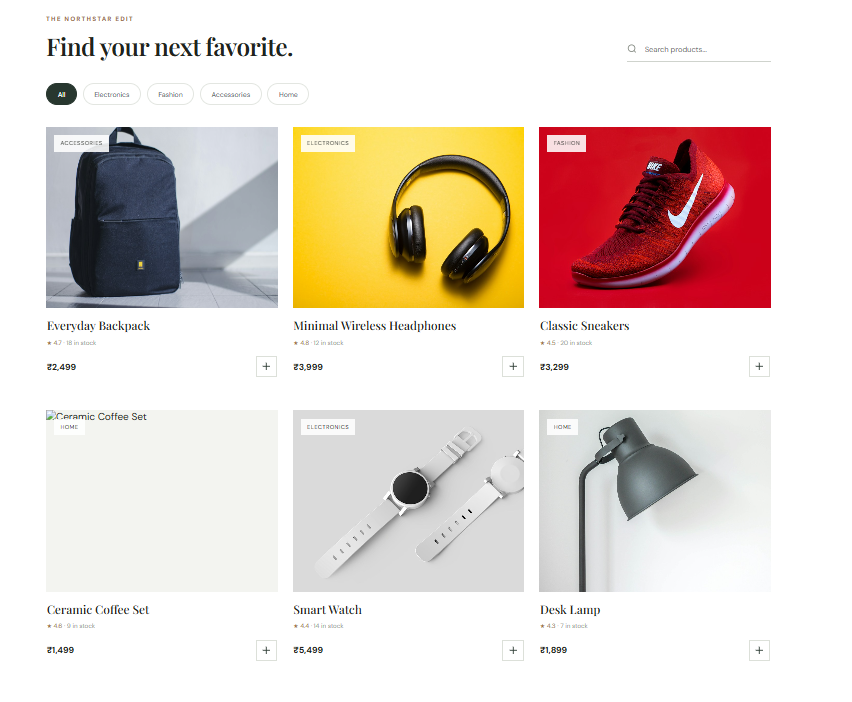
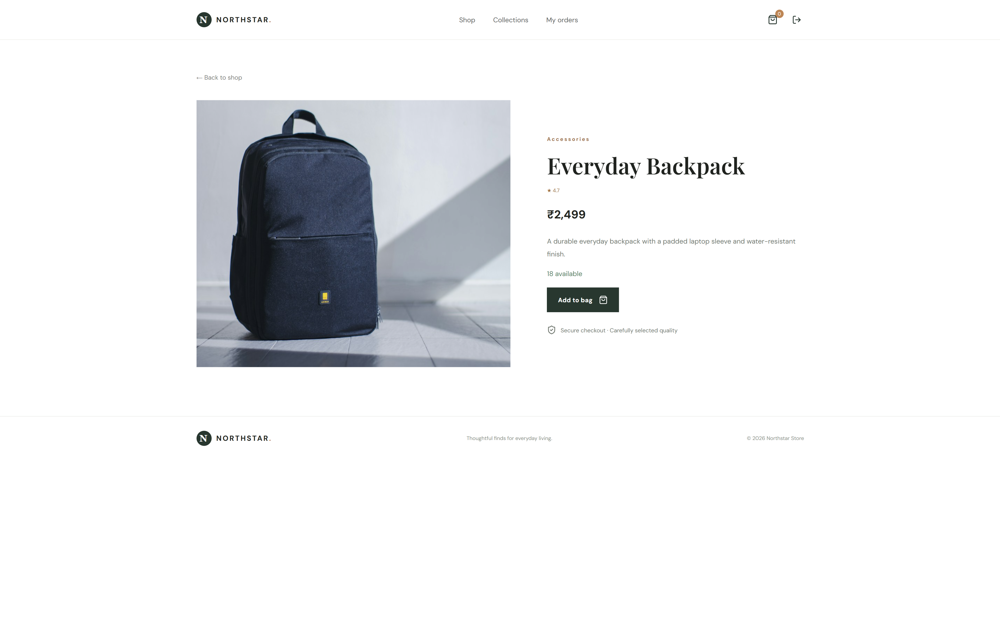
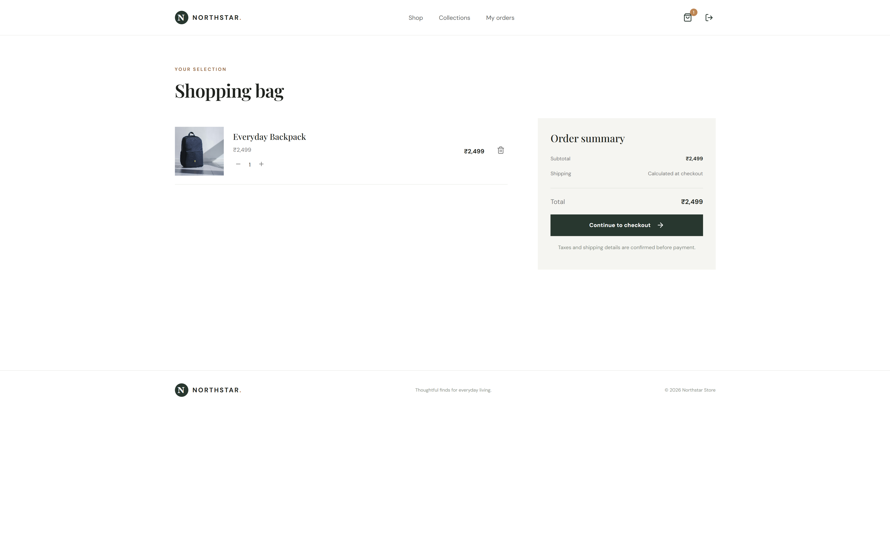
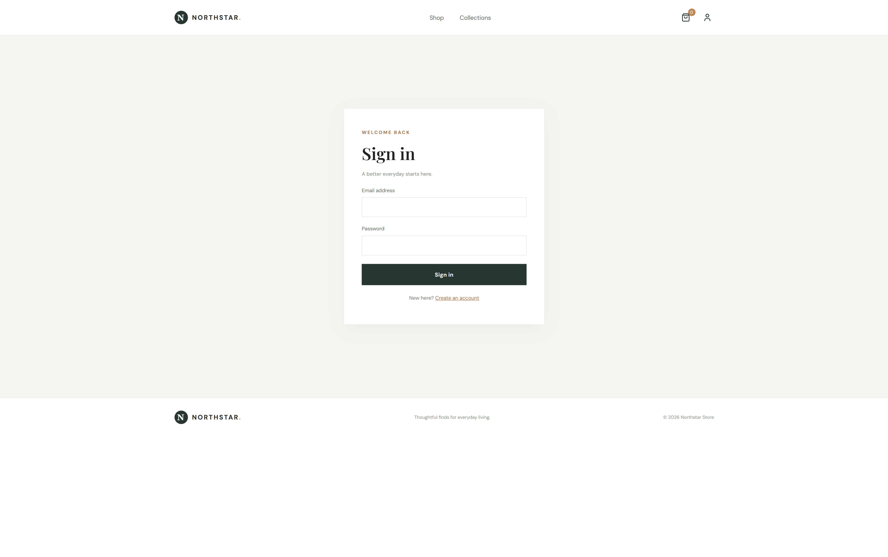
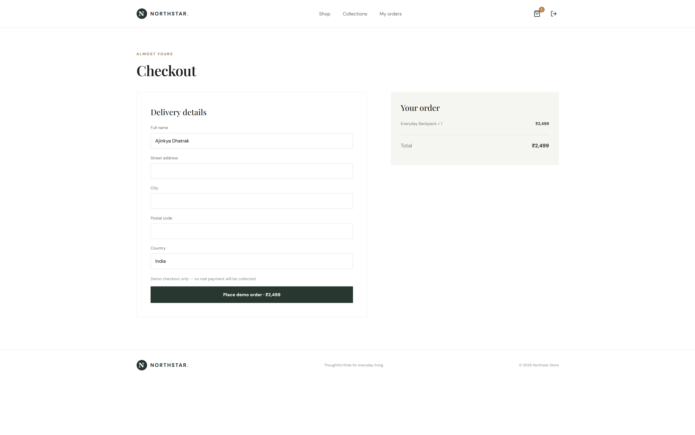
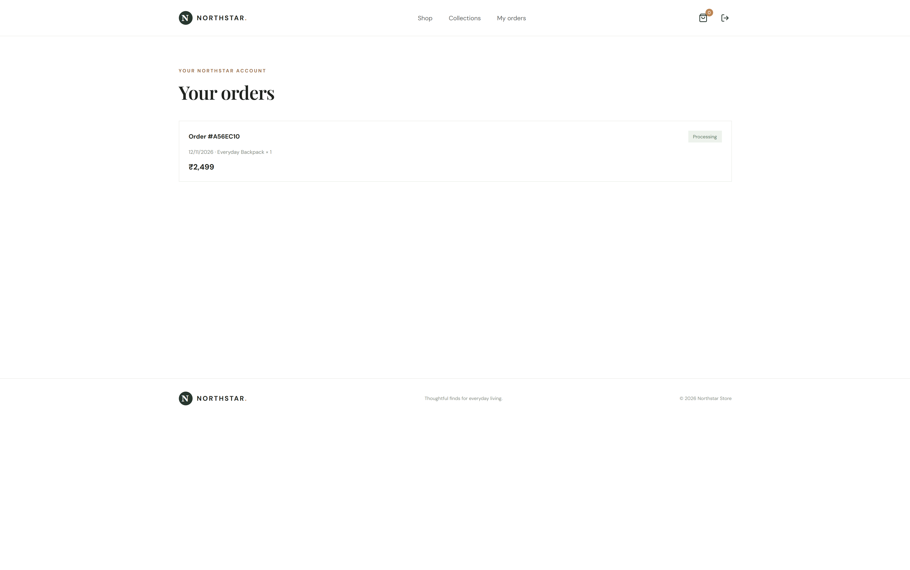
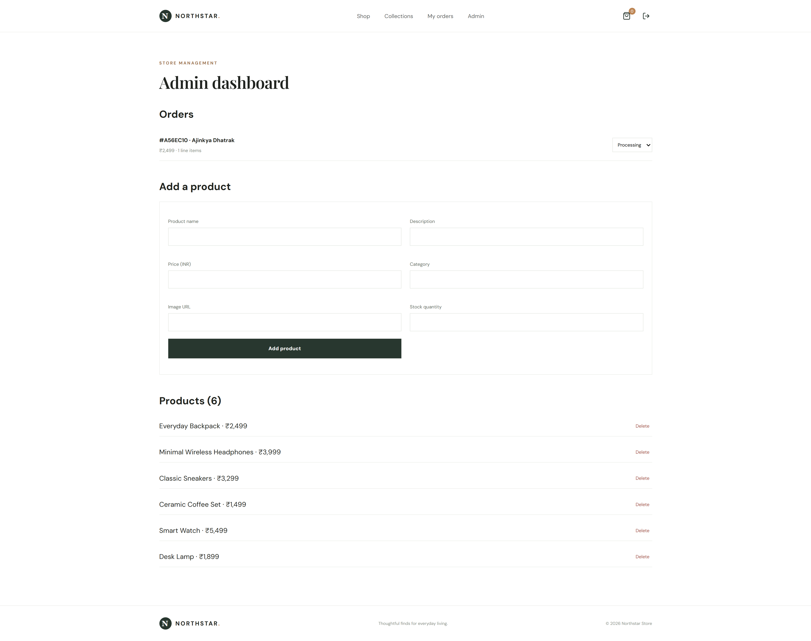

# 🛍️ Northstar - MERN E-commerce Store

<!-- Tech Stack Badges -->
<p align="center">
  
  
  
  
  
  
  
  
</p>

## 📌 About The Project

**Northstar** is a modern, full-stack E-commerce application built using the MERN stack (MongoDB, Express.js, React.js, and Node.js).

It provides a complete online shopping experience with product browsing, search, category filtering, user authentication, shopping cart management, checkout, order tracking, and an admin dashboard.

The application features a clean, responsive user interface designed to deliver a smooth shopping experience across desktop and mobile devices.

## 📸 Screenshots

### 🏠 Home Page

<!-- Replace with your actual screenshot -->


### 🛍️ Product Listing



### 📦 Product Details



### 🛒 Shopping Cart



### 🔐 Authentication



### 💳 Checkout



### 📋 My Orders



### ⚙️ Admin Dashboard



## ✨ Features

### 👤 User Features

- User registration and login.
- Secure password hashing using bcrypt.
- JWT-based authentication.
- Browse available products.
- Search products by name.
- Filter products by category.
- View detailed product information.
- Add products to shopping cart.
- Update product quantities.
- Remove products from cart.
- Persistent shopping cart using local storage.
- Checkout with shipping details.
- Place orders.
- View personal order history.
- Track order status.

### 🛠️ Admin Features

- Admin authentication and authorization.
- Dedicated admin dashboard.
- Add new products.
- View all available products.
- Delete products.
- View customer orders.
- Update order status.
- Manage store inventory through product stock quantities.

### 🎨 UI Features

- Modern and clean design.
- Fully responsive layout.
- Product cards with images and ratings.
- Category filtering.
- Interactive shopping cart.
- Mobile-friendly navigation.
- Lucide icons.

## 🧰 Tech Stack

**Frontend**

- React.js
- React Router DOM
- Vite
- JavaScript (ES6+)
- CSS3
- Lucide React

**Backend**

- Node.js
- Express.js
- RESTful APIs
- JSON Web Token (JWT)
- bcrypt.js

**Database**

- MongoDB
- Mongoose ODM

**Development Tools**

- Git
- GitHub
- Visual Studio Code
- npm

## 📁 Project Structure

```text
mern-ecommerce-store/
│
├── client/
│   ├── public/
│   ├── src/
│   │   ├── App.jsx
│   │   ├── main.jsx
│   │   └── style.css
│   ├── index.html
│   ├── package.json
│   └── .env.example
│
├── server/
│   ├── src/
│   │   ├── index.js
│   │   └── seed.js
│   ├── package.json
│   └── .env.example
│
├── .gitignore
└── README.md
```

## ⚙️ Installation & Setup

Follow these steps to run the project locally.

### 1. Clone the Repository

```bash
git clone https://github.com/ajinkya029/mern-ecommerce-store.git
```

### 2. Navigate to the Project

```bash
cd mern-ecommerce-store
```

### 3. Setup Backend

```bash
cd server
npm install
```

Create a `.env` file inside the server directory.

```env
PORT=5000
MONGO_URI=mongodb://127.0.0.1:27017/mern_store
JWT_SECRET=your_secret_key
CLIENT_URL=http://localhost:5173
```

Configure your MongoDB connection string and JWT secret.

### 4. Seed Sample Products

```bash
npm run seed
```

This command creates sample products and a demo admin account.

### 5. Start Backend Server

```bash
npm run dev
```

Backend runs at:

```text
http://localhost:5000
```

### 6. Setup Frontend

Open another terminal:

```bash
cd client
npm install
```

Create a `.env` file inside the client directory:

```env
VITE_API_URL=http://localhost:5000/api
```

### 7. Start Frontend

```bash
npm run dev
```

Frontend runs at:

```text
http://localhost:5173
```

## 🔑 Demo Admin Credentials

Use the following credentials to access the admin dashboard:

| Field    | Credentials       |
| -------- | ----------------- |
| Email    | admin@example.com |
| Password | Admin123!         |

**Note:** These are demo credentials. Change them before deploying the application publicly.

## 🔗 API Endpoints

### Authentication

| Method | Endpoint             | Description   |
| ------ | -------------------- | ------------- |
| POST   | `/api/auth/register` | Register user |
| POST   | `/api/auth/login`    | Login user    |

### Products

| Method | Endpoint                  | Description            |
| ------ | ------------------------- | ---------------------- |
| GET    | `/api/products`           | Get all products       |
| GET    | `/api/products/:id`       | Get product details    |
| POST   | `/api/admin/products`     | Add product (Admin)    |
| PUT    | `/api/admin/products/:id` | Update product (Admin) |
| DELETE | `/api/admin/products/:id` | Delete product (Admin) |

### Orders

| Method | Endpoint                       | Description                 |
| ------ | ------------------------------ | --------------------------- |
| POST   | `/api/orders`                  | Create order                |
| GET    | `/api/orders/my`               | Get logged-in user's orders |
| GET    | `/api/admin/orders`            | Get all orders (Admin)      |
| PATCH  | `/api/admin/orders/:id/status` | Update order status (Admin) |

## 🛒 Shopping Workflow

1. Browse products from the home page.
2. Search or filter products by category.
3. Select a product to view its details.
4. Add the product to your shopping cart.
5. Update quantities or remove items.
6. Register or log in to your account.
7. Enter shipping information.
8. Place your order.
9. View your order history.

## 🔒 Security

- Password hashing using bcrypt.
- JWT-based authentication.
- Protected API routes.
- Admin-only routes and operations.
- Input validation for important operations.

## 🚀 Future Improvements

- Stripe or Razorpay payment gateway integration.
- Product reviews and ratings.
- Wishlist functionality.
- Product pagination and sorting.
- Image upload using Cloudinary.
- Email notifications.
- Forgot password functionality.
- Advanced inventory management.
- Deployment with MongoDB Atlas.

## ⚠️ Important Note

The current checkout implementation creates orders without processing real payments. It is intended for development and demonstration purposes.

Before production deployment, integrate a payment gateway and implement server-side payment verification, stronger security controls, and appropriate inventory handling.

## 👨‍💻 Author

**Ajinkya Dhatrak**

GitHub: [@ajinkya029](https://github.com/ajinkya029)

---

⭐ If you like this project, consider giving it a star!
